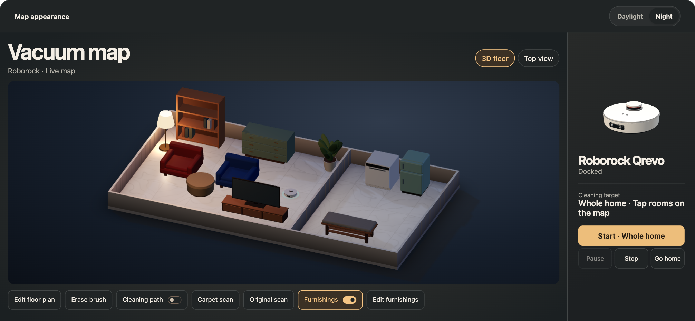
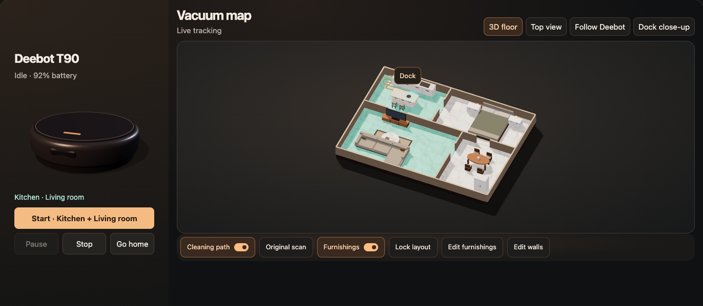
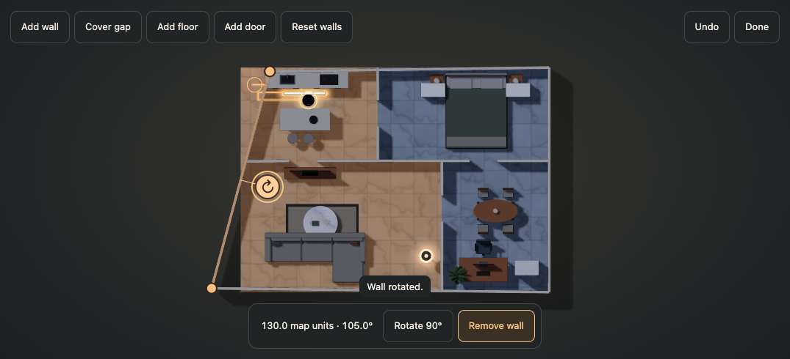

# T90 3D Map Card

Build an editable 3D floor plan from your robot’s map in Home Assistant. Choose rooms, follow the vacuum, and furnish the floor plan in your browser. Stable v0.2.0 supports the Ecovacs Deebot T90. The [v0.3.0-beta.1 preview](https://github.com/gdelagardelle/t90-map-card/releases/tag/v0.3.0-beta.1) adds Roborock Qrevo support. All screenshots use fictional maps.






## Before installing

- **Roborock Qrevo** users need the official Home Assistant Roborock integration, a saved map with stock colors, and the vacuum and map image entities for the same device. Install the beta below.
- **Ecovacs T90** users should connect their T90 through the [Home Assistant Ecovacs integration](https://www.home-assistant.io/integrations/ecovacs/). Finish mapping at least one room in the Ecovacs app.
- Find the vacuum and its **map image** under **Settings → Devices & services → Ecovacs → your Deebot**. Enable the map image entity if it is disabled. You need a `vacuum.*` entity and an `image.*` entity that serves the Ecovacs SVG vector map.
- Use a dashboard managed through the Home Assistant UI to save room assignments or share a furnished layout across devices. Saving requires permission to edit that dashboard. Use a browser with WebGL 2 for the 3D view.

## Install with HACS

1. Open **HACS → ⋮ → Custom repositories**. Paste `https://github.com/gdelagardelle/t90-map-card` and choose **Dashboard** as the type.
2. Add the repository, open **T90 3D Map Card**, and choose **Download** (or **Redownload**). For Roborock, open **Need a different version?** and select **v0.3.0-beta.1**. Reload your dashboard after installation.
3. Edit your dashboard and select **Add card → T90 3D Map**. Select your map source, vacuum, and its map image.

This repository can be added directly to HACS. [HACS custom repository instructions](https://www.hacs.xyz/docs/faq/custom_repositories/)

## Manual install

1. Download [the beta JavaScript module](https://github.com/gdelagardelle/t90-map-card/releases/download/v0.3.0-beta.1/t90-map-card.js) and place it at `config/www/t90-map-card.js`.
2. In **Settings → Dashboards → ⋮ → Resources**, add `/local/t90-map-card.js` as a **JavaScript module**. Enable Advanced Mode in your user profile if Resources is hidden. Reload the page.
3. Use the visual editor or add a manual card with your own entity IDs.

```yaml
type: custom:t90-map-card
entity: vacuum.my_deebot
map_entity: image.my_deebot_map
```

| Option | What to select |
| --- | --- |
| `entity` | The vacuum you want the buttons to control |
| `map_entity` | The map image for the same device |

Both fields are required. For Roborock, also set the map source as shown below. No token or external map URL is needed. For a second robot, add another card and select that device’s vacuum and image.

## Roborock Qrevo preview

Choose **Roborock Qrevo (stock map colors)** in the card editor, then select the vacuum and its map image from the same device in the official [Home Assistant Roborock integration](https://www.home-assistant.io/integrations/roborock/). For manual configuration:

```yaml
type: custom:t90-map-card
map_source: roborock_qrevo
entity: vacuum.my_qrevo
map_entity: image.my_qrevo_map_0
```

The Qrevo view renders modeled walls and a textured floor in the browser from the native map image. Drag to orbit, zoom, or choose **Top view**. The robot, dock, carpets and recorded path update when Home Assistant supplies a new image. Their visibility depends on the integration’s map settings. The native image includes the recorded path as drawn by Roborock. The **Cleaning path** and **Carpet scan** switches start off. Each remembers your choice per floor in this browser. The renderer estimates the surface beneath hidden scan markings from neighboring pixels. Rugs placed in the furniture editor are separate. When the card recognizes the stock robot marker, it places a white 3D Qrevo with a lidar turret at that position. The side panel shows the same illustrative model. If the marker is missing or ambiguous the renderer keeps the source image markings. Use **Original scan** to compare your design with the current Roborock image. The Ecovacs path-reset feature applies to the Ecovacs vector map.

### Edit and render a Qrevo floor

For clusters of scan marks, choose **Erase brush** directly on the map toolbar. Adjust **Brush size**, then tap a pillar or drag over several. To trim a stray floor patch, open **Edit floor plan** and choose **Delete floor** in the Tool menu. Drag over the patch. Existing raised walls stay in place. Each stroke has its own **Undo**. Choose **Save to dashboard** to keep the cleanup.

While editing the floor plan or furnishings, use **+** and **−**, scroll over the spot you want to inspect, or pinch with two fingers. During a pinch, moving both fingers pans the map. Tap the zoom percentage to fit the whole floor again.

1. Open **Edit floor plan**. Choose **Whole floor** or a room under **Surface**, then choose **Wood planks**, **Marble**, **Tile** or **Solid color**. The color picker adjusts the selected finish. Room-specific finishes rely on distinct stock room colors.
2. With **Select wall**, tap a scan wall or a wall you drew. The highlighted footprint shows what will change. Drag the middle grip to move the wall, drag an end to change its angle or length, or choose **Delete wall**. Use **Undo** to reverse the edit. Drag a rectangle with **Make floor** over furniture-leg marks to flatten them. Drag **Draw wall** between two points to add a wall at any angle. Use **Cut doorway** across a wall to open a passage, or across its end to shorten it. **Undo** reverses the last surface or wall edit.
3. Press **Render 3D** to orbit the design. Under **Edit furnishings**, choose a piece, tap to place it, drag to move it, and use its corner and rotation handles to adjust it.
4. Press **Save to dashboard** to share the design across devices. Browser drafts are kept locally when storage is available. Each vacuum and floor has its own layout. On a remap, the card checks image dimensions and sampled wall landmarks and pauses the saved edits if they no longer align. These edits change the view in Home Assistant. The robot continues to use its own map for navigation.

On a single saved floor, tap a room’s stock floor color or open **Choose rooms**. Check the names on **Start**, then press it to clean. Path markings, carpets, ambiguous colors and walls do not select a room. The room buttons also work for rooms obscured by overlays. Keep the default integration colors for map taps. Multiple saved floors can be viewed individually via their image entities; room commands are available only with one reported floor. Pause, resume, stop and return to dock use the selected vacuum entity.

Map rendering and room selections have been exercised against Qrevo 2 Pro Series and Qrevo Edge 2 Set images. Room commands were verified with a service recorder. Other Roborock families and physical room-clean execution have not been verified.

## Map appearance

Choose **Daylight** or **Night** at the top of the card. Daylight pairs a pale marble map with the cleaning controls below it. Night uses cooler shadows and amber lighting, with the robot alongside the map on wide dashboards. The choice is remembered in this browser for the configured vacuum and map. You can switch while editing or tracking a cleaning run.

## Clean rooms with a Deebot T90

Tap a room on the floor. On the first tap, choose its Ecovacs room name and select **Save room**. Repeat for each room you want to target. Once a room is matched, tapping it toggles its highlight. You can also select rooms under **Choose rooms**.

Read the Start button before tapping it. **Start · Kitchen + Living room** sends those two room IDs. **Start · Whole home** starts a whole-home clean. Tapping the map alone never starts the robot. While paused, **Resume** continues the existing job. **Change a map room name** lets you correct an assignment.

The glowing marker follows the latest reported position. The card checks the map while the dashboard is visible. Update speed depends on how often the integration publishes a new image. A new observed cleaning run masks the previous run’s path. Settings, dock actions, and maintenance readings depend on which entities the integration exposes and enables for your device.

## Edit your Deebot floor plan

| Gesture | Result |
| --- | --- |
| **Edit walls**, then select a wall | Shows its length in map units and its angle |
| Drag the round ↻ handle | Rotates the wall around its midpoint |
| Drag either endpoint | Changes the wall’s length while anchoring its opposite end |
| Drag the wall itself | Moves the wall sideways, taking connected edges and attached doors with it |
| **Add wall**, **Add door**, or **Cover gap** | Tap the start and end points on the map |
| **Add floor** | Tap around the boundary, then choose **Finish floor** |
| **Edit furnishings → Add furniture** | Choose an item and tap its position |
| **Select a piece → Color** | Choose a swatch or a custom color. **Original color** restores the factory finish for that piece. |
| Drag a piece, its corner, or its ↻ handle | Moves, resizes, or rotates the furnishing |
| **Done → Lock layout** | Hides geometry editing on this browser and leaves room selection available |

Both map sources share the furniture palette. Under **Resize**, **Keep proportions** starts on. Drag a corner or adjust either slider to scale a piece uniformly. Turn it off to change width and depth separately. Widening a TV board or desk keeps its screen at its original size. Narrowing the base sufficiently also reduces the screen, keeping its aspect ratio.

Browse by room for a bedside table, shoe cabinet, round side table, dining chair, oven and hob, and coat rack. It includes an armchair, ottoman, bookcase, dresser, media console, entry bench, retro refrigerator and dishwasher. A finish applies to the selected piece and is saved with its layout. The palette also includes an **office desk** with a monitor, a separate **office chair**, a **potted plant**, a **floor lamp**, and an **LED strip**. Turn off **Keep proportions** to stretch the strip lengthwise. The strip glows along its full length, including the ends. The floor lamp casts a softer circular pool. Both effects are stronger in Night. They are visual furnishings and do not send commands to a physical light.

Lengths use the map’s coordinate system. Physical calibration is deferred. Edits customize the dashboard drawing. The robot continues to navigate with its Ecovacs map. New installations start with an unfurnished floor.




### Save and restore

Edits are saved in the current browser. To share them with other browsers on the same dashboard, open **Room layout → Save this layout to the dashboard**. **Export layout file** downloads your wall and furnishing edits. Import the file on the same vacuum and map configuration. Exported files contain layout information, so share them only with people you intend to give it to.

Saved edits and room assignments are scoped to the configured vacuum, map image and detected floor geometry. A remap that changes the floor geometry starts a separate layout and room matching session. Renaming the configured entity IDs also changes the storage scope. Use one card for each vacuum/map pair on a storage dashboard if you want the card to write its layout there.

## Compatibility

The first version targets the Deebot T90 map format from Home Assistant’s Ecovacs integration. The public module has browser tests with fictional devices and floor plans, and has rendered a real T90 SVG. A second physical household installation is still unverified.

Other robots can expose standard [Home Assistant vacuum actions](https://www.home-assistant.io/integrations/vacuum/). Bringing a different model into this card also requires compatible room outlines, coordinates, and room-cleaning commands. A raster map alone does not supply the wall geometry. The Qrevo beta estimates wall geometry from the official integration’s stock PNG. Other map formats require a compatible adapter.

## Troubleshooting

| Symptom | What to check |
| --- | --- |
| Custom element does not exist | Confirm the HACS download or manual resource URL, the JavaScript module type, and reload the dashboard |
| Waiting for the map | Open the configured map image in Home Assistant, check the vacuum is available, and confirm both selected entities belong to the same device |
| Unsupported map format | Choose the Ecovacs map source for a T90 SVG or Roborock Qrevo for a stock Roborock map image. Confirm that the configured image belongs to the selected vacuum |
| 2D outlines appear instead of 3D | Check that WebGL 2 and browser hardware acceleration are available |
| Tapping a room opens the name picker | Match it once with the Ecovacs room ID. Use a dashboard account with edit permission to save the match |
| Missing mop or dock controls | Inspect the device’s available and disabled entities in the Ecovacs integration |
| Layout differs on another device | Save the layout to the dashboard and reload it on the other device. The layout lock is local to each browser |
| The robot appears stationary | Check the timestamp and position in the source map. The card uses the position reported by Home Assistant |

## Development

Use Node.js 22 or later. The checked-in distribution contains the 3D renderer, editor, and card as one ES module. The card obtains its map from the signed-in Home Assistant session and uses Home Assistant’s service API for commands.

```sh
npm ci
npm run build
npx playwright-core install chromium
npm test
```

Set `CHROME_BIN` to use an installed Chromium or Chrome executable. Run `node tests/browser.mjs --pictures` to regenerate the README screenshots from the fictional fixture. The browser tests record commands in memory. They exercise map loading, room targeting, editing, lock persistence, floor changes, and two vacuum configurations.

When reporting an issue, include the card version, Home Assistant version, robot model, browser, and the message the card displayed. A fictional or redacted example is enough to start a map-format investigation.

## License

The card is distributed under the [MIT license](LICENSE). The bundled Three.js renderer includes its [MIT license](licenses/three.txt).
