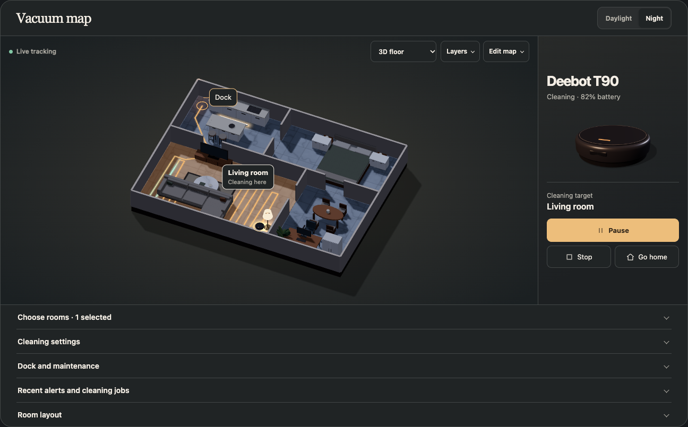
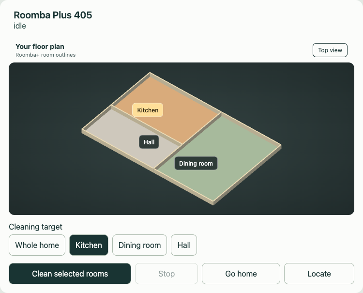
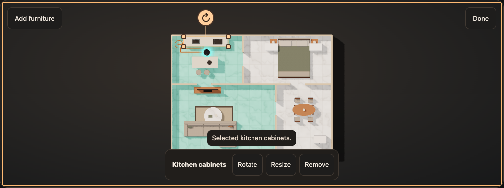

# T90 3D Map Card

Turn your Ecovacs Deebot T90’s own map into an editable 3D floor plan in Home Assistant. Tap rooms to choose where to clean, see the target on the Start button, and follow the robot and its cleaning path. For Roomba, Roborock, Dreame, SwitchBot, Shark, Xiaomi, Matter, and Valetudo, use the [robot compatibility and downloads table](#which-download-fits-your-robot). The T90 screenshots use a fictional four-room home.




## Which download fits your robot?

Start with the row for the integration that owns your Home Assistant vacuum entity. Each tester is a standalone browser module. HACS installs the T90 card; the other downloads below use manual dashboard resources.

| Robot and integration | Install or enable first | What the card can show or do | Download and evidence |
|---|---|---|---|
| **Ecovacs Deebot T90** | Built-in [Ecovacs](https://www.home-assistant.io/integrations/ecovacs/), a completed map, and its enabled SVG map image | Editable native 3D floor, robot, dock, trail, room selection and device controls | [Stable T90 release](https://github.com/gdelagardelle/t90-map-card/releases/tag/v0.2.0). Rendered on a T90 dashboard. |
| **Roborock Qrevo 2 Pro Series and Qrevo Edge 2 Set** | Built-in [Roborock](https://www.home-assistant.io/integrations/roborock/), saved floor and stock-color map image | 3D reconstruction from the robot’s image, map editing and room targeting | [Beta 3 download](https://github.com/gdelagardelle/t90-map-card/releases/tag/v0.3.0-beta.3) · [Setup and tested models](https://github.com/gdelagardelle/t90-map-card/tree/v0.3.0-beta.3#roborock-qrevo-preview). Actual map images and recorded room commands. |
| **Dreame L40S Pro Ultra** | Install [Tasshack’s Dreame Vacuum](https://github.com/Tasshack/dreame-vacuum), then select the vacuum and its current map camera | Native 3D room outlines, pose, dock, trail, and selected-segment cleaning | [Dreame module](dist/dreame-map-card-beta.js) · [Setup](docs/dreame.md). L40S fixtures and a recorded L10s Ultra map replay. |
| **SwitchBot** | Set up [SwitchBot Cloud](https://www.home-assistant.io/integrations/switchbot_cloud/) with a supported vacuum, a SwitchBot Hub and a SwitchBot account. For room commands on an S10 or supported EU K10+, see the optional community integration in the guide. | Advertised controls and suction; optional user-drawn 3D plan or supplied image. Room targets require a compatible integration. The official vacuum entity supplies no tracking coordinates. | [SwitchBot module](dist/switchbot-vacuum-card.js) · [Models and installation](testers/switchbot/START-HERE.md). Simulated entities and recorded actions. |
| **Classic Wi-Fi iRobot Roomba / Braava** | Built-in [iRobot Roomba and Braava](https://www.home-assistant.io/integrations/roomba/). Pair the robot on the local network. Upstream examples include the 980, 960, s9+ and Braava jet m6. | Supported vacuum or mop controls; relative trail when the vacuum supplies positions. Optional user-drawn floor plan. | [Vacuum controls module](dist/vacuum-controls-card.js) · [Roomba setup](testers/vacuum-controls/START-HERE.md). Fixture-tested. |
| **Newer iRobot x05 / Roomba+** | The built-in integration excludes newer x05 models including 105, 405 and 505. Prime/V4 models require an iRobot cloud account. Check exact model coverage in [Roomba+](https://github.com/johnnyh1975/ha_roomba_plus) before installing the community integration. | Controls from the exposed entity. A paired Rooms Map with native polygons can render in 3D. Room targeting requires unambiguous integration IDs and the room action. | [Vacuum controls module](dist/vacuum-controls-card.js) · [Roomba+ prerequisites](testers/vacuum-controls/START-HERE.md). Fixture-tested capabilities. |
| **Shark IQ** | Built-in [Shark IQ](https://www.home-assistant.io/integrations/sharkiq/) and a supported robot in your Shark account | Standard controls and optional named-room cleaning on vacuums that report rooms. Optional supplied image or manual floor plan. | [Vacuum controls module](dist/vacuum-controls-card.js) · [Shark setup](testers/vacuum-controls/START-HERE.md). Fixture-tested. |
| **Xiaomi Mi Robot Vacuum via xiaomi_miio** | Pair a compatible model in the Xiaomi Home app, then add the built-in [Xiaomi Home (xiaomi_miio)](https://www.home-assistant.io/integrations/xiaomi_miio/) integration | Standard controls and advertised suction options. Optional supplied map image or manual floor plan. | [Vacuum controls module](dist/vacuum-controls-card.js) · [Xiaomi setup](testers/vacuum-controls/START-HERE.md). Fixture-tested. |
| **Matter robot vacuum (RVC)** | A compatible vacuum commissioned into the built-in [Matter integration](https://www.home-assistant.io/integrations/matter/). Thread devices also need a Thread border router. | Start and Stop; additional commands when advertised. This tester does not import a Matter floor map or dispatch Matter area cleaning. | [Vacuum controls module](dist/vacuum-controls-card.js) · [Commissioning and hardware](testers/vacuum-controls/MATTER.md). Capability fixtures. |
| **Robots already running Valetudo** | A [supported robot](https://valetudo.cloud/pages/general/supported-robots/) running Valetudo, an MQTT broker, Home Assistant MQTT discovery, and its map-data camera | Native 3D map viewer for reported floor/walls, segments, robot, dock, and path. Use the HA vacuum entity for commands. | [Valetudo map module](dist/valetudo-map-card.js) · [MQTT and camera setup](testers/valetudo/README.md). Encoded camera fixtures and replay of 30 upstream v2 maps. |

Fixture-tested means the browser loaded the actual card, used realistic Home Assistant entity or map data, and recorded the target of commands. Physical cleaning on the Dreame, SwitchBot, iRobot, Shark, Xiaomi, Matter and Valetudo configurations still needs owner confirmation. Upstream support for a model describes the integration. Available card features depend on what that particular vacuum exposes.

### Install a tester from this repository

1. Add the integration from the table. Confirm the vacuum and any required map entity work in Home Assistant first.
2. Open the module linked in your row and use GitHub’s **Download raw file** button. Alternatively, use **Code → Download ZIP** on this branch and take the matching JavaScript file from `dist/`. The module includes its rendering dependencies.
3. Follow your row’s setup guide for the destination under `config/www/`, the matching `/local/…` JavaScript module resource, and the Manual card YAML. Reload the dashboard after saving. HACS and manual copies of the same custom element should share a single registration.
4. Start with a visual check. Compare the robot, map or displayed room name with the vendor app. On cards that support room commands, selecting a room updates the target; pressing the cleaning action sends the command.

The Roborock beta and stable Ecovacs release both register `custom:t90-map-card`. Choose one version of that resource per Home Assistant installation. The other modules use separate element names and can coexist.

The Roomba+ example below shows a fictional three-room floor rendered by the actual tester. Kitchen is selected and the cleaning action is ready.



## Before installing the Ecovacs T90 card

- Connect your T90 through the [Home Assistant Ecovacs integration](https://www.home-assistant.io/integrations/ecovacs/). Finish mapping at least one room in the Ecovacs app.
- Find the vacuum and its **map image** under **Settings → Devices & services → Ecovacs → your Deebot**. Enable the map image entity if it is disabled. You need a `vacuum.*` entity and an `image.*` entity that serves the Ecovacs SVG vector map.
- Use a dashboard managed through the Home Assistant UI to save room assignments or share a furnished layout across devices. Saving requires permission to edit that dashboard. Use a browser with WebGL 2 for the 3D view.

## Install with HACS

1. Open **HACS → ⋮ → Custom repositories**. Paste `https://github.com/gdelagardelle/t90-map-card` and choose **Dashboard** as the type.
2. Add the repository, open **T90 3D Map Card**, and download it. Reload your dashboard.
3. Edit your dashboard and select **Add card → T90 3D Map**. Pick your vacuum and its map image from the two dropdowns.

This repository can be added directly to HACS. [HACS custom repository instructions](https://www.hacs.xyz/docs/faq/custom_repositories/)

## Manual install

1. Download [the built JavaScript module](https://raw.githubusercontent.com/gdelagardelle/t90-map-card/main/dist/t90-map-card.js) and place it at `config/www/t90-map-card.js`.
2. In **Settings → Dashboards → ⋮ → Resources**, add `/local/t90-map-card.js` as a **JavaScript module**. Enable Advanced Mode in your user profile if Resources is hidden. Reload the page.
3. Use the visual editor or add a manual card with your own entity IDs.

```yaml
type: custom:t90-map-card
entity: vacuum.my_deebot
map_entity: image.my_deebot_map
```

| Option | What to select |
| --- | --- |
| `entity` | The T90 vacuum you want the buttons to control |
| `map_entity` | The Ecovacs map image for the same device |

Both fields are required. No token or external map URL is needed. For a second robot, add another card and select that device’s vacuum and image.

## Map appearance

Choose **Daylight** or **Night** at the top of the card. Daylight pairs a pale marble map with the cleaning controls below it. Night uses cooler shadows and amber lighting, with the robot alongside the map on wide dashboards. The choice is remembered in this browser for the configured vacuum and map. You can switch while editing or tracking a cleaning run.

## Clean rooms

Tap a room on the floor. On the first tap, choose its Ecovacs room name and select **Save room**. Repeat for each room you want to target. Once a room is matched, tapping it toggles its highlight. You can also select rooms under **Choose rooms**.

Read the Start button before tapping it. **Start · Kitchen + Living room** sends those two room IDs. **Start · Whole home** starts a whole-home clean. Tapping the map alone never starts the robot. While paused, **Resume** continues the existing job. **Change a map room name** lets you correct an assignment.

The glowing marker follows the latest reported position. The card checks the map while the dashboard is visible. Update speed depends on how often the integration publishes a new image. A new observed cleaning run masks the previous run’s path. Settings, dock actions, and maintenance readings depend on which entities the integration exposes and enables for your device.

## Edit your floor plan

| Gesture | Result |
| --- | --- |
| **Edit walls**, then select a wall | Shows its length in map units and its angle |
| Drag the round ↻ handle | Rotates the wall around its midpoint |
| Drag either endpoint | Changes the wall’s length while anchoring its opposite end |
| Drag the wall itself | Moves the wall sideways, taking connected edges and attached doors with it |
| **Add wall**, **Add door**, or **Cover gap** | Tap the start and end points on the map |
| **Add floor** | Tap around the boundary, then choose **Finish floor** |
| **Edit furnishings → Add furniture** | Choose an item and tap its position |
| Drag a piece, its corner, or its ↻ handle | Moves, resizes, or rotates the furnishing |
| **Done → Lock layout** | Hides geometry editing on this browser and leaves room selection available |

The furniture palette includes an **office desk** with a monitor, a separate **office chair**, a **potted plant**, a **floor lamp**, and an **LED strip**. Stretch the strip lengthwise with the resize handles. The strip glows along its full length, including the ends. The floor lamp casts a softer circular pool. Both effects are stronger in Night. They are visual furnishings and do not send commands to a physical light.

Lengths use the map’s coordinate system. Physical calibration is deferred. Edits customize the dashboard drawing. The robot continues to navigate with its Ecovacs map. New installations start with an unfurnished floor.




### Save and restore

Edits are saved in the current browser. To share them with other browsers on the same dashboard, open **Room layout → Save this layout to the dashboard**. **Export layout file** downloads your wall and furnishing edits. Import the file on the same vacuum and map configuration. Exported files contain layout information, so share them only with people you intend to give it to.

Saved edits and room assignments are scoped to the configured vacuum, map image and detected floor geometry. A remap that changes the floor geometry starts a separate layout and room matching session. Renaming the configured entity IDs also changes the storage scope. Use one card for each vacuum/map pair on a storage dashboard if you want the card to write its layout there.

## Troubleshooting

| Symptom | What to check |
| --- | --- |
| Custom element does not exist | Confirm the HACS download or manual resource URL, the JavaScript module type, and reload the dashboard |
| Waiting for the map | Open the configured map image in Home Assistant, check the vacuum is available, and confirm both selected entities belong to the same device |
| Unsupported map format | Check that you selected the Ecovacs SVG map entity. Camera snapshots, PNG and JPEG maps cannot be converted by this version |
| 2D outlines appear instead of 3D | Check that WebGL 2 and browser hardware acceleration are available |
| Tapping a room opens the name picker | Match it once with the Ecovacs room ID. Use a dashboard account with edit permission to save the match |
| Missing mop or dock controls | Inspect the device’s available and disabled entities in the Ecovacs integration |
| Layout differs on another device | Save the layout to the dashboard and reload it on the other device. The layout lock is local to each browser |
| The robot appears stationary | Check the timestamp and position in the source map. The card uses the position reported by Home Assistant |

## Development

Use Node.js 22 or later. Each checked-in dashboard module is self-contained. Build from the repository root. The card obtains its map from the signed-in Home Assistant session and uses Home Assistant’s service API for commands.

```sh
npm ci
npm run build
npx playwright-core install chromium
npm test
```

Set `CHROME_BIN` to use an installed Chromium or Chrome executable. For additional Dreame and SwitchBot cross-browser checks, run `npx playwright-core install firefox webkit` followed by `npm run test:cross-browser`. The Roomba/Shark/Xiaomi and Valetudo browser tests also accept `TEST_BROWSER=firefox` or `TEST_BROWSER=webkit`. Run `node tests/browser.mjs --pictures` to regenerate the README screenshots from the fictional fixture. The browser tests record commands in memory. They exercise map loading, room targeting, editing, lock persistence, floor changes, and two vacuum configurations.

When reporting an issue, include the card version, Home Assistant version, robot model, browser, and the message the card displayed. A fictional or redacted example is enough to start a map-format investigation.

## License

The card is distributed under the [MIT license](LICENSE). The bundled Three.js renderer includes its [MIT license](licenses/three.txt).
